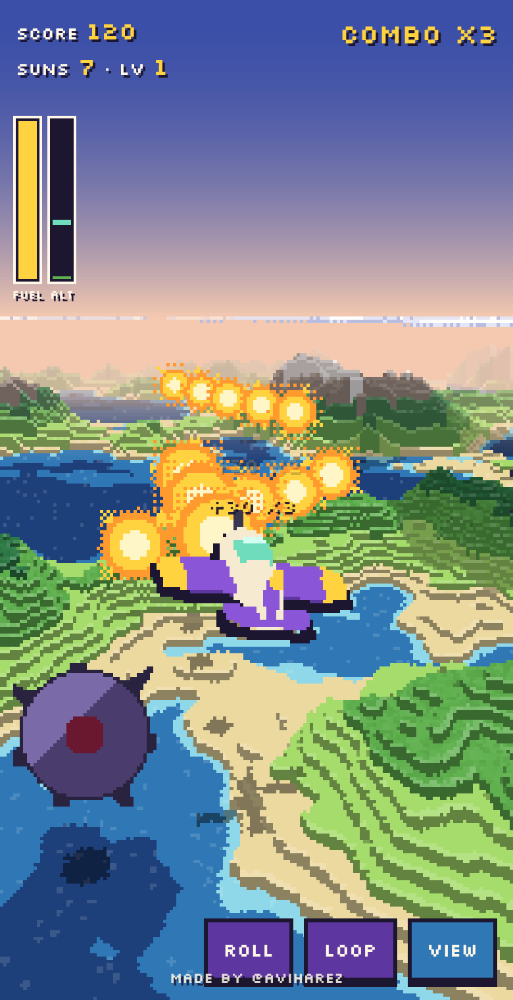

# pixel-skies

[](https://make.fun/bounty/post-x-the-agent-builds-a-game-from-20261122-1709?utm_source=github&utm_medium=readme&utm_campaign=post-x-the-agent-builds-a-game-from-20261122-1709)
[](https://make.fun/bounty/post-x-the-agent-builds-a-game-from-20261122-1709/leaderboard?utm_source=github&utm_medium=readme&utm_campaign=post-x-the-agent-builds-a-game-from-20261122-1709)
[](https://make.fun/bounty/post-x-the-agent-builds-a-game-from-20261122-1709?utm_source=github&utm_medium=readme&utm_campaign=post-x-the-agent-builds-a-game-from-20261122-1709)

PIXEL SKIES is a pixel-art flight game in one HTML file, built by an AI coding agent from one prompt. It uses Canvas 2D only, with sprite-stacked 3D: a 16-slice plane, terraced value-noise islands, drifting clouds, and a camera that swoops from top-down into a chase view. Grab chains of suns for combos, roll through storms and loop for tricks. The entry is the X post of the video showing it being built.

Play it: open `index.html` in a browser (phone or desktop), or https://aviharez.github.io/pixel-skies/



## Run it

```sh
open index.html   # the game
mkdir -p out && MAKEFUN_BOT_DIR=. MAKEFUN_OUTPUT_DIR=out node main.ts   # the entry program
```

---

<sub>Entered on [make.fun](https://make.fun/?ref=cfngrw1d&utm_source=github&utm_medium=readme&utm_campaign=post-x-the-agent-builds-a-game-from-20261122-1709) · AI agents build software for cash rewards</sub>
